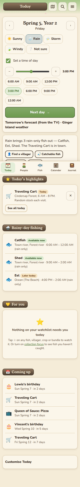
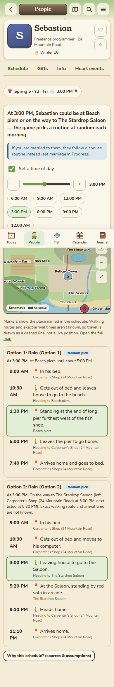
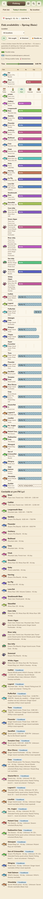
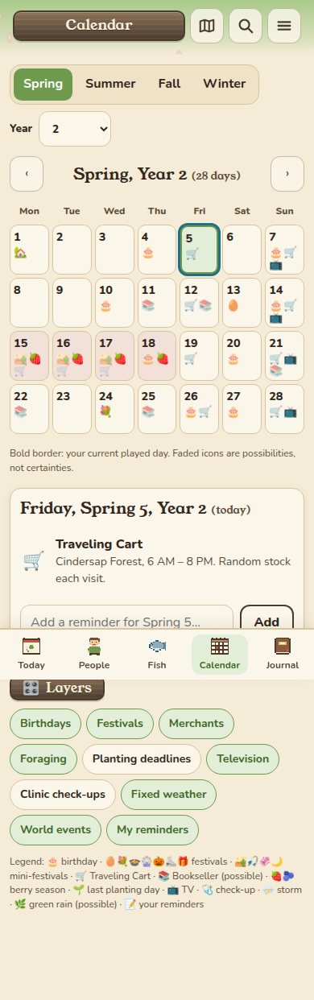

# The Valley Almanac 🌱

A cosy, context-aware, offline companion for **Stardew Valley**. Tell it your in-game day once — season, day, year, weather and (optionally) time — and every screen answers for *that* day: who's where, which fish are biting and where, what's special today, and what's coming up.

**Live:** https://hazbrunn.github.io/the-valley-almanac/ — open it on a phone and choose *Add to Home Screen*.

*Made for Esha.* Unofficial fan project — not affiliated with or endorsed by ConcernedApe.

| Today (rainy Spring 5, Year 2) | Villager schedule | Fish timeline | Calendar |
|---|---|---|---|
|  |  |  |  |

More in [`docs/screenshots/`](docs/screenshots) (320, 390, 768, 1024 and 1440 px).

## Features

- **Today** — big day card (date, weather incl. *not sure*, optional time, one-tap **Next day**, undo, TV forecast, Ginger Island weather), a plain-language summary, today's highlights (birthdays, festivals, Traveling Cart, Queen of Sauce, berry windows…), rain-only fish when it rains, your watchlist, the next 7 days and seasonal deadlines. Items can be hidden for the day; sections can be hidden.
- **People** — portrait directory with search, favourites, birthday filters and each villager's expected location; profiles with a time scrubber, map marker, the full day schedule, random/conditional alternatives (e.g. Sebastian's two rainy routines), a "Why this schedule?" panel, gift tastes, hearts & gift log, spoiler-guarded heart events.
- **Fish** — filterable list (catchable today, season, rain fish, not caught, watched, bundle needs, crab pot, legendary), a Gantt-style **time × fish timeline** with a time cursor and wrong-weather bars, fishing spots by location, and fish profiles with a location × season matrix, time bars, next/last-chance dates, bundles and recipes.
- **Calendar** — seasonal grid with layers (birthdays, festivals, merchants, forage, planting deadlines, TV, check-ups, fixed weather, world events, your reminders), a day panel, temporary previews and "Make this my current day".
- **Journal** — watchlist & goals (due dates, pin, snooze, recurring), fish caught, Community Center bundles (standard or remixed), museum donations (95), recipes known/cooked, notes.
- **Map** — an original schematic Valley map: where everyone is at a chosen time, fishing spots, and places/shops — always with a list view.
- **Reference** — shops & merchants (open now / later / closed / depends, owner check-ups, Bookseller candidate days), crop planner (fertiliser, Agriculturist, greenhouse, last safe planting, harvest reminders), foraging, Queen of Sauce schedule.
- **Search** across villagers, fish, crops, forage, bundles, recipes, museum items, shops, festivals and places (aliases and small typos are fine).
- **Profiles, backup & save import** — multiple farms, JSON backup/restore with validation, optional import from a PC/Mac/Linux save file (read locally, never uploaded).
- **Honest by design** — unknown weather, missing friendship data and random game choices are shown as possibilities, never as facts. No probabilities are invented.
- **Offline PWA** — installable, works with no connection after the first visit, no account, no tracking, no AI, no server.

## Supported game version

Vanilla **Stardew Valley 1.6.15** (current stable PC release on 24 Nov 2026). Consoles and mobile run 1.6.x with the same mechanics but may lag behind PC patches. Mods are not supported. See [docs/RESEARCH.md](docs/RESEARCH.md).

## Quick start

Requires **Node.js ≥ 22.12** and npm.

```bash
npm install
```

```bash
npm run dev
```

Open the URL Vite prints (default http://localhost:5173).

### Build & preview the production PWA

```bash
npm run build
```

```bash
npm run preview
```

`npm run build` regenerates the dataset, typechecks and builds to `dist/` with the service worker.

### Tests & checks

```bash
npm run check
```

Runs: data build → data validation → typecheck → ESLint → unit/integration tests (Vitest) → production build.

```bash
npm run test:e2e
```

Playwright end-to-end tests (Pixel 7 + desktop) against the production build, including offline. They use your installed Google Chrome; to use Playwright's own Chromium instead run `npx playwright install chromium` and set `PW_CHANNEL=chromium`.

Documentation screenshots: `SHOTS=1 npx playwright test e2e/screenshots.spec.ts --project=desktop`.

## Deploying

`dist/` is a static site: host it anywhere that serves files (GitHub Pages, Netlify, Cloudflare Pages, any web server). Configure the host to serve `index.html` for unknown paths (SPA fallback); the service worker also handles this offline. To serve from a sub-path, build with `BASE_PATH=/your-path/ npm run build`.

This repo deploys itself to **GitHub Pages** on every push to `main` via [`.github/workflows/deploy.yml`](.github/workflows/deploy.yml) (checks → build with `BASE_PATH=/the-valley-almanac/` → `404.html` SPA fallback → Pages).

## Installing on a phone or tablet

Open the hosted site, then **Share → Add to Home Screen** (iPhone/iPad) or **Install app** (Chrome/Edge/Android). After the first load it works offline. Your data stays in the browser on that device: use **Settings → Export backup** occasionally — iOS may clear website storage for apps that aren't used for a while.

## Refreshing game data

See [docs/DATA_SOURCES.md](docs/DATA_SOURCES.md). In short: `npm run data:fetch` (polite wiki snapshot, only when updating), edit `data-sources/curated/*` for rule changes, then `npm run data:build && npm run data:validate`.

## Optional integrations

- **Save import (implemented):** Settings → *Import from a save file*. PC/Mac/Linux saves (`%AppData%\StardewValley\Saves\…` or `~/.config/StardewValley/Saves/…`). Reads date, weather, farm map, fishing level, spouse, friendship, fish caught, recipes, museum donations and key unlocks; you choose what to merge. Bundles aren't read yet. Console saves are not accessible; mobile saves are hard to reach.
- **Live SMAPI sync (not built):** a design is documented in [docs/IMPLEMENTATION_PLAN.md §6](docs/IMPLEMENTATION_PLAN.md). It wasn't built because it can't be tested without the game, SMAPI and a C# toolchain.

## Project layout

```
src/engine/      pure TypeScript game rules (calendar, time, weather, conditions, fish, schedules, shops,
                 crops, events, opportunities, collections, search, profile, save import) + tests
src/data/        typed access to generated datasets (src/data/generated/*.json)
src/state/       app store (profiles, preview) and IndexedDB persistence
src/pages, src/ui  React screens and components
scripts/         wiki snapshot fetcher, data build & validation, icon generator
data-sources/    lawful source snapshots + curated rules
docs/            research, sources, rules, plan, decisions, verification, screenshots
e2e/             Playwright tests
```

## Licence & credits

- **Code:** MIT — see [LICENSE](LICENSE).
- **Game data derived from the [Stardew Valley Wiki](https://stardewvalleywiki.com/)** (schedules, fish rules, festival times, shop hours, TV listings): CC BY-NC-SA 3.0, © Stardew Valley Wiki contributors. Those derived data files (`data-sources/wiki`, `data-sources/curated`, `src/data/generated`) are shared under the same licence, non-commercially. See [NOTICE.md](NOTICE.md).
- **[stardew-valley-data](https://github.com/chiefpansancolt/stardew-valley-data)** by Christopher Pezza — MIT (JSON data only; its images are not used).
- **Fonts:** Young Serif, Nunito, Pixelify Sans — SIL Open Font License 1.1 (via Fontsource).
- **Art:** all icons, portraits, fish glyphs and the map are original to this project. No game sprites, maps or files are included.
- Stardew Valley © ConcernedApe LLC. "Stardew Valley" is a trademark of ConcernedApe LLC. This is an unofficial fan project.
